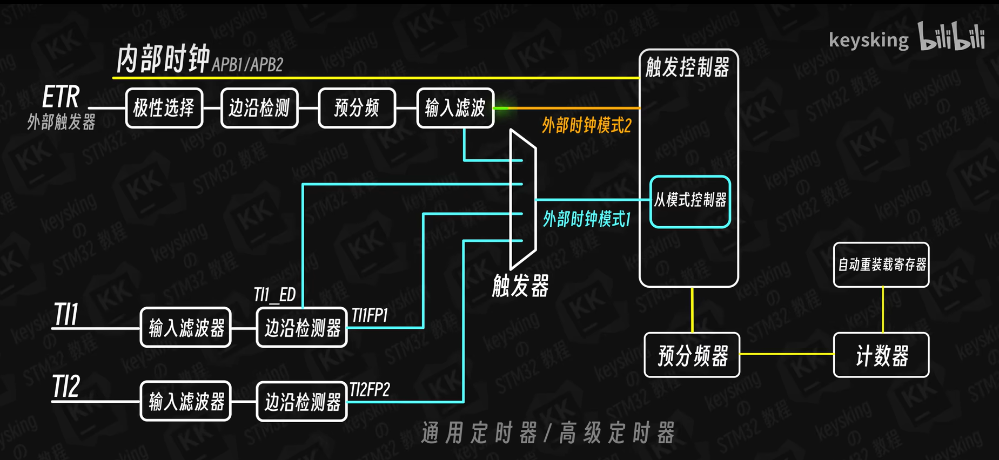
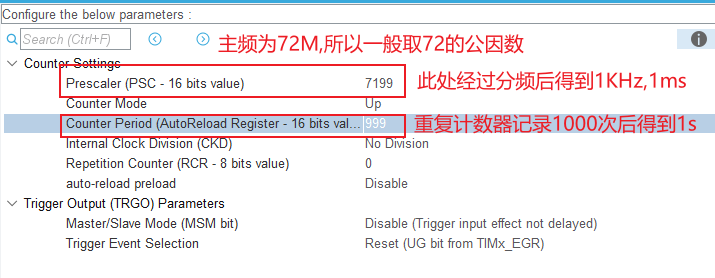
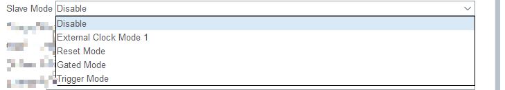
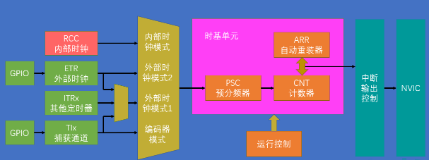
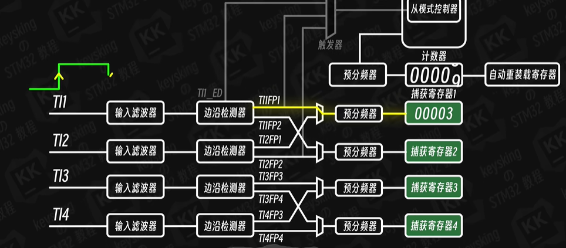
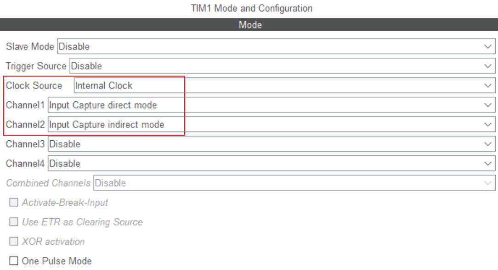
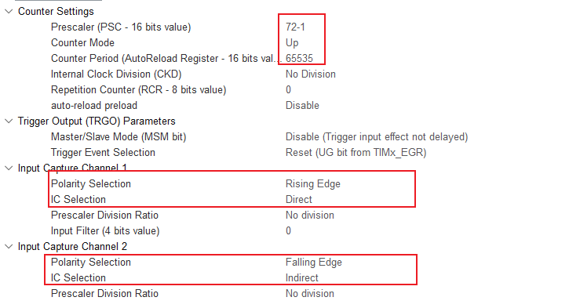
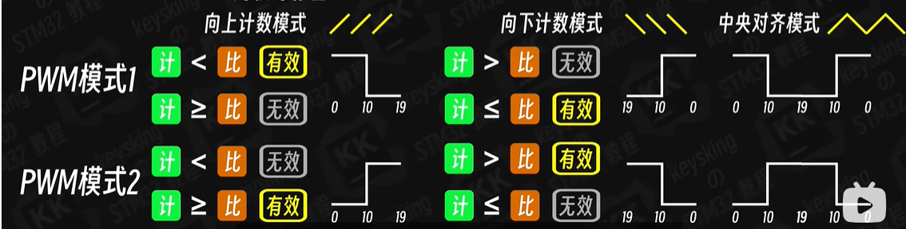
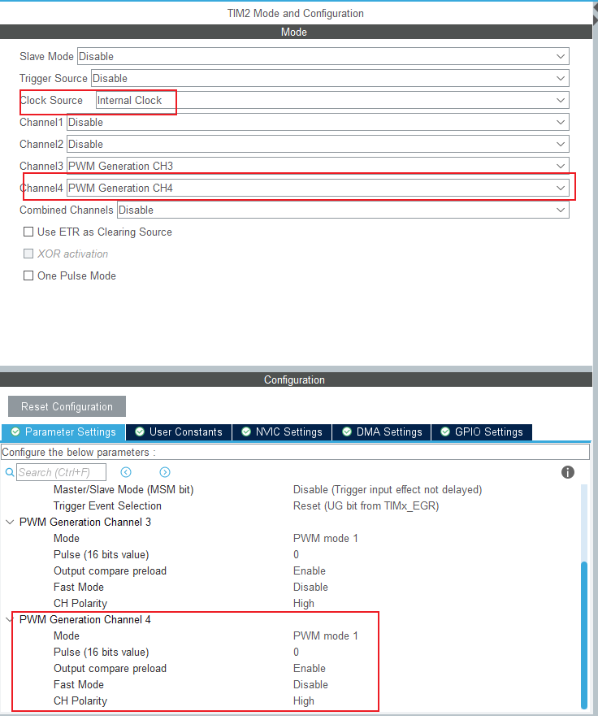
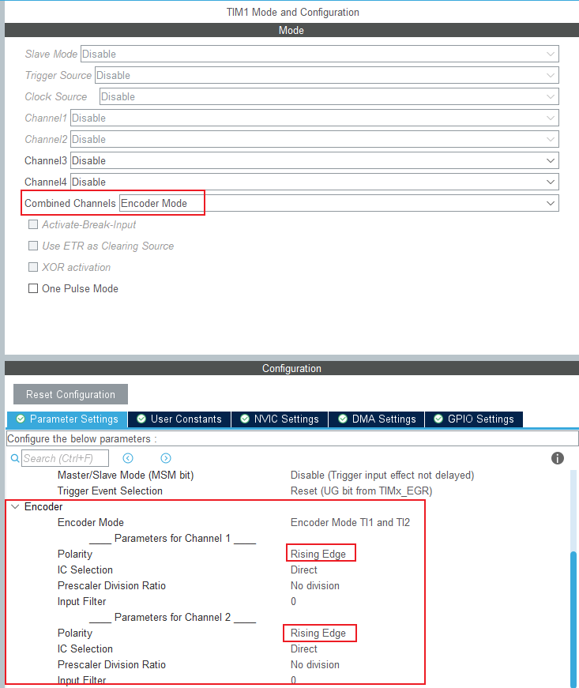

# STM32F103C8T6 定时器


## 定时器分类回顾



## 基本定时器（内部计数）

- 核心特点：不依赖外部输入信号，完全依赖内部时钟计数，适合做定时中断、时基参考、计时任务等。
- 本节重点：理解内部时钟触发路径、分频与计数器换算，以及 HAL 库定时实现思路。

### 1. 内部时钟的简要说明，以及触发路径

- 基本定时器的时钟源来自内部时钟 `CK_INT`，通常不直接使用系统时钟 `SYSCLK`，而是由 RCC 时钟树分发后进入定时器。对于 STM32F1，`SYSCLK` 一般为 `72MHz`，而 APB1 总线默认分频系数为 2，所以挂接到 TIMx 的时钟常见值为 `36MHz`（即 `72MHz / 2`）。
- 触发路径可以概括为：`RCC -> APB1 时钟 -> TIMx_CK_INT -> PSC 预分频器 -> CNT 计数器 -> ARR 自动重装 -> 更新事件/中断`。

### 2. 频率与时钟的换算，例如计时 500ms，分频器和计数器的换算

- 基本公式：
  - `计数频率 = CK_INT / ((PSC + 1) × (ARR + 1))`
  - `定时周期 = (PSC + 1) × (ARR + 1) / CK_INT`
  
- 其中
  - `PSC`：预分频器，控制计数器输入频率，区间为0~65535
  - `ARR`：自动重装值，控制计数器达到多少后溢出，区间为0~65535
  - 如计时1S:
  
  


| 场景                           | 推荐组合          | 原因                   |
| ------------------------------ | ----------------- | ---------------------- |
| **PWM 呼吸灯、LED亮度等**      | ✅ 小 PSC + 大 ARR | 提高占空比精度（平滑） |
| **马达控制**                   | ✅ 小 PSC + 大 ARR | 高精度 PWM 控制        |
| **需要很高定时精度（微秒级）** | ✅ 小 PSC + 大 ARR | 提供高时间分辨率       |
| **定时中断（只要求某个频率）** | ✅ 大 PSC + 小 ARR | 简单节省资源           |
| **粗略定时（1s, 10s等）**      | ✅ 大 PSC + 小 ARR | 可读性高，占用小       |
| **资源紧张、对精度要求低**     | ✅ 大 PSC + 小 ARR | 省资源                 |

| 控制项    | 控制作用             | 对占空比的影响         |
| --------- | -------------------- | ---------------------- |
| **ARR**   | PWM周期长度 / 档位数 | 越大，占空比越精细     |
| **PSC**   | 计数步长（计时粒度） | 影响频率和响应时间     |
| **CCR值** | 当前的占空比         | 比例 = CCR / (ARR + 1) |

### 3.HAL 库实现1s定时（大纲）

- 通过cubemx生成的项目结构（需要勾选TIM的更新中断事件，否则不会进入中断函数）

  ```txt
  project-tree
  interrupt_TIM_Count/
  ├── CMakeLists.txt                # CMake 构建入口
  ├── CMakePresets.json             # 编译预设配置
  ├── startup_stm32f103xb.s         # STM32 启动文件
  ├── STM32F103xx_FLASH.ld          # Flash/RAM 链接脚本
  ├── Core/
  │   ├── Inc/
  │   │   ├── main.h
  │   │   ├── gpio.h
  │   │   ├── tim.h
  │   │   ├── OLED.h
  │   │   ├── stm32f1xx_hal_conf.h
  │   │   └── stm32f1xx_it.h
  │   └── Src/
  │       ├── main.c               # 主程序
  │       ├── gpio.c               # GPIO 初始化
  │       ├── tim.c                # TIM1 定时计数与中断
  │       ├── OLED.c               # OLED 显示驱动
  │       ├── stm32f1xx_it.c       # 中断处理
  │       └── system_stm32f1xx.c  # 系统时钟初始化
  ├── Drivers/                     # STM32 HAL / CMSIS 驱动
  ├── cmake/                       # CMake 工具链和 CubeMX 配置
  ├── build/                       # 编译输出目录
  ├── interrupt_TIM_Count.ioc      # STM32CubeMX 配置文件
  └── README.md                   # 项目说明
  ```

- 生成之后在`tim.c`中添加：

  ```C
  /* USER CODE BEGIN 1 */
  uint32_t overValue = 0;
  // TIM溢出中断回调函数
  void HAL_TIM_PeriodElapsedCallback(TIM_HandleTypeDef *htim)
  {
      if(htim == &htim1)
      {
          overValue++; 
      }
  }
  
  /* USER CODE END 1 */
  ```

- `main.c`中的` MX_TIM1_Init();`后添加:

  ```C
    __HAL_TIM_SET_COUNTER(&htim1, 0); // 将计数器清零
    HAL_TIM_Base_Start_IT(&htim1); // 启动定时器 TIM1，并使能中断
  ```

### 从模式

- 从模式（Slave Mode）是指：定时器不直接使用内部时钟自由计数，而是接收外部触发信号或其他定时器的事件来决定是否计数、启动、停止、复位或同步。这类模式的作用就是把多个定时器、外部信号和传感器进行了硬件联动，其核心思想是：**被触发器控制运行**，常用于编码器、同步采样、PWM同步、外部事件计数和联合定时。
- 在 STM32 里，常见的从模式包括：

| 从模式 | 简要说明 | 作用 |
| --- | --- | --- |
| `External Clock Mode 1` | 将外部脉冲作为真正的计数时钟，计数器按外部事件递增；这是少数“外部脉冲做计数时钟”的模式 | 常用于外部脉冲计数、编码器/传感器同步 |
| `Reset Mode` | 外部触发事件到来时，复位计数器； | 用于重新开始计数、同步复位 |
| `Gated Mode` | 外部信号作为门控信号，只有在有效电平期间才计数； | 用于“有条件地计数”，例如使能窗口计时 |
| `Trigger Mode` | 外部触发事件启动一次计数/操作；可以多次触发，定时器计数会一直计数，常与单脉冲（one Pulse mode）使用 | 用于单次触发采样、启动任务 |

- 统一理解：`非 External Clock Mode 1` 的从模式，仍然使用内部时钟 `CK_INT` 作为计数时钟；外部信号只负责控制启动、停止、复位、门控或同步动作。

- 只有 `External Clock Mode 1` 才是把外部脉冲当作计数时钟，计数器按外部事件递增。

  **Reset Mode 案例（HAL 库，外部触发启动计数）**：

  - 设定：`TIM1 作为从定时器，外部 GPIO 上升沿触发后，`TIM1` 才开始计数。

  - 作用：等待外部事件到来，再启动计时，不需要 CPU 手动调用 `HAL_TIM_Base_Start()`。

    ```C
    // TIM.h: 需要配置函数定义及变量-- extern uint32_t overflow_count; // 用于记录定时器溢出次数 
    // TIM1.c
    void MX_TIM1_Init(void) {
    
        /* USER CODE BEGIN TIM1_Init 0 */
    
        /* USER CODE END TIM1_Init 0 */
    
        TIM_ClockConfigTypeDef sClockSourceConfig = {0};
        TIM_SlaveConfigTypeDef sSlaveConfig = {0};
        TIM_MasterConfigTypeDef sMasterConfig = {0};
    
        /* USER CODE BEGIN TIM1_Init 1 */
    
        /* USER CODE END TIM1_Init 1 */
        htim1.Instance = TIM1;
        htim1.Init.Prescaler = 7199;
        htim1.Init.CounterMode = TIM_COUNTERMODE_UP;
        htim1.Init.Period = 50000;
        htim1.Init.ClockDivision = TIM_CLOCKDIVISION_DIV1;
        htim1.Init.RepetitionCounter = 0;                             // 重复计数器设置为0
        htim1.Init.AutoReloadPreload = TIM_AUTORELOAD_PRELOAD_ENABLE; // 自动重装载预装载功能启用
        if (HAL_TIM_Base_Init(&htim1) != HAL_OK) {
            Error_Handler();
        }
        sClockSourceConfig.ClockSource = TIM_CLOCKSOURCE_INTERNAL;
        if (HAL_TIM_ConfigClockSource(&htim1, &sClockSourceConfig) != HAL_OK) {
            Error_Handler();
        }
        // 设置为复位模式 此外还有 TIM_SLAVEMODE_GATED、TIM_SLAVEMODE_TRIGGER、TIM_SLAVEMODE_EXTERNAL1 等模式
        sSlaveConfig.SlaveMode = TIM_SLAVEMODE_RESET; 
        sSlaveConfig.InputTrigger = TIM_TS_TI1FP1; // 触发源选择PA8
        sSlaveConfig.TriggerPolarity = TIM_TRIGGERPOLARITY_RISING;  // 设置触发极性为上升沿
        sSlaveConfig.TriggerFilter = 0; // 初始值
        if (HAL_TIM_SlaveConfigSynchro(&htim1, &sSlaveConfig) != HAL_OK) {
            Error_Handler();
        }
        sMasterConfig.MasterOutputTrigger = TIM_TRGO_RESET;
        sMasterConfig.MasterSlaveMode = TIM_MASTERSLAVEMODE_DISABLE;
        if (HAL_TIMEx_MasterConfigSynchronization(&htim1, &sMasterConfig) != HAL_OK) {
            Error_Handler();
        }
        
    ```

    

- 这段代码的关键点是：**定时器使用内部时钟自己开始计数，外部触发沿到来后刷新计数器**。这正是 `Start Mode` 的典型应用。

- 如果只是“外部脉冲持续计数”，那是 `External Clock Mode 1`；如果只是“外部事件触发开始计数”，那就是 `Start Mode`。


- 说明：`Trigger Mode` 的本质是“等待外部事件再开始计数”，可以设置单次触发（one Pulse mode），而 `External Clock Mode 1` 则是“外部脉冲持续作为计数时钟”。两者都属于从模式，但动作不同。


## 通用定时器和高级定时器


- 时钟源：内部时钟CK_INT、外部时钟1 TIx、外部时钟2：外部中断触发ETR、内部触发输入 ITRx
- 高级控制定时器 (TIM1 和 TIM8) 和通用定时器在基本定时器的基础上引入了外部引脚，可以实 现输入捕获和输出比较功能
- 高级控制定时器比通用定时器增加了可编程死区互补输出、重复计 数器、带刹车 (断路) 功能，这些功能都是针对工业电机控制方面。
- 外部时钟1_TIx：时钟信号（TI1/2/3/4）配置：1.配置TI映射，2.设置滤波 3.触发方式选择 4.触发源选择 5.外部时钟触发模式选择
- 外部时钟2_TIMx_ETR：TIMx_ETR配置：1.映射 2. 触发方式选择 3. 预分频（小于16MHz）4.设置滤波 5.外部时钟触发模式选择
- 内部时钟_ITRx：内部触发：内部触发输入是使用一个定时器作为另一个定时器的预分频器


TIM1 的核心功能

| 应用         | 使用功能                                                     | 说明                 |
| ------------ | ------------------------------------------------------------ | -------------------- |
| LED 调光     | PWM 输出（PWM1 高电平有效，PWM2 低电平有效）                 | 调节亮度，占空比控制 |
| 电机调速     | PWM 输出 + 死区时间（作用：防止半桥上下 MOS 管在切换时同时导通，避免击穿） | 控制功率桥臂导通     |
| 舵机控制     | PWM 输出（50Hz）                                             | 位置角度控制         |
| 三相逆变器   | 互补PWM + 中心对齐 + 死区时间                                | 平衡三相波形         |
| 编码器测速   | 输入捕获 / 编码器模式                                        | 测速与方向           |
| 同步ADC采样  | 主从触发输出 TRGO                                            | 定时触发ADC转换      |
| 系统定时任务 | 定时中断                                                     | 周期事件触发         |


### 通用定时器 - 输入捕获（TIM1_CH1）



**输入捕获（Input Capture, IC）\**是 STM32 定时器（如前面提到的 TIM1）非常核心的一个功能。简单来说，它的主要作用是\**测量外部脉冲信号的参数**（例如：测量脉冲宽度、高电平持续时间、信号周期或频率）。所以输入捕获需要监听两个信号，也就是需要成对监听；


- **超声波模块**
  - 四脚超声波模块通常包含 VCC、TRIG、ECHO、GND。TRIG 接收满足模块时序要求的触发脉冲后，模块发射超声波；声波遇到目标后反射。ECHO 高电平持续时间通常表示声波从发射到接收的往返传播时间。
  - 设 ECHO 高电平时间为 t，声速为 c，目标距离为 d。声波走了往返路程，因此：
$$
d=\frac{c\times t}{2}
$$

- **项目配置**

  - 基本配置：TIM1 通道1和2分别监听上升沿（直接模式）及下降沿（间接模式）

    

    

  CH1 与 CH2 捕获的是同一根 PA8/ECHO 信号的两个不同边沿。CH1 使用 `HAL_TIM_IC_Start()`，只开启硬件捕获、不请求 CH1 中断；CH2 使用 `HAL_TIM_IC_Start_IT()`，在下降沿产生 TIM1 捕获比较中断。

  - 捕获处理流程
       - 清除旧捕获数据和标志，计数器归零
         → PA10 输出 10 μs 触发脉冲
         → ECHO 上升沿：CH1 将计数值保存到 CCR1
         → ECHO 下降沿：CH2 将计数值保存到 CCR2，并触发中断
         → 中断读取 CCR1、CCR2，置位 `captureComplete`
         → 主循环检测到捕获完成后计算并显示距离；40 ms 超时则显示 0

`TIM_FLAG_CC1` 是硬件捕获标志，表示 CCR1 已有一次捕获结果。它不是软件完成标志；在 CH1 不开启中断的设计中，用它确认下降沿到来前已有上升沿捕获。

`captureComplete` 标记一次完整脉冲

```C
// main.c
int main(void) {
    HAL_Init();
    SystemClock_Config();
    MX_GPIO_Init();
    MX_TIM1_Init();
    /* USER CODE BEGIN 2 */
    OLED_Init();
    OLED_ShowString(1, 1, "DT:");
    OLED_ShowString(2, 1, "RE:");
    OLED_ShowString(3, 1, "FE:");
    HAL_TIM_IC_Start(&htim1, TIM_CHANNEL_1);    // 上升沿仅硬件捕获，不启用中断
    HAL_TIM_IC_Start_IT(&htim1, TIM_CHANNEL_2); // 下降沿捕获并产生中断
    while (1) {

        // 清理捕获标志和计数器
        risingEdge = 0;
        fallingEdge = 0;
        // 每轮开始先标记为未完成，避免没有收到完整回波时沿用上次结果。
        captureComplete = 0; // 标记一次完整的脉冲检测
        // 清除上一轮残留的捕获及溢出标志，防止旧捕获被误认为本轮数据。
        __HAL_TIM_CLEAR_FLAG(&htim1, TIM_FLAG_CC1 | TIM_FLAG_CC2 | TIM_FLAG_CC1OF | TIM_FLAG_CC2OF);
        __HAL_TIM_SET_COUNTER(&htim1, 0); // 重置计数器

        // 发送触发脉冲（持续10 us）并且等待回波返回或超时（40 ms）
        HAL_GPIO_WritePin(TRIG_GPIO_Port, TRIG_Pin, GPIO_PIN_SET);
        delay_us(10U);
        HAL_GPIO_WritePin(TRIG_GPIO_Port, TRIG_Pin, GPIO_PIN_RESET);

        // 等待下降沿中断完成捕获，最多等待 40 ms(所以最大距离为 40*1000 * 0.034/2 = 680cm)；HAL_Delay(1) 让出 CPU，捕获由硬件/中断完成。
        uint32_t captureStart = HAL_GetTick();
        while ((captureComplete == 0U) && ((HAL_GetTick() - captureStart) < 40U));

        // 只有捕获到完整回波才计算距离；超时或无回波时显示 0。
        OLED_ShowNum(1, 4, captureComplete ? return_distance_cm() : 0U, 6);
        OLED_ShowString(1, 11, "cm");
        OLED_ShowNum(2, 4, risingEdge, 6);
        OLED_ShowNum(3, 4, fallingEdge, 6);
        HAL_Delay(100);
    }
    /* USER CODE END 3 */
}
```


```C
// Delay.c

#include "delay.h"
#include "stm32f1xx_hal.h"

// us级函数延迟
void delay_us(uint32_t us) {
    CoreDebug->DEMCR |= CoreDebug_DEMCR_TRCENA_Msk;
    DWT->CTRL |= DWT_CTRL_CYCCNTENA_Msk;

    uint32_t start = DWT->CYCCNT;
    uint32_t cycles = (SystemCoreClock / 1000000U) * us;
    while ((uint32_t)(DWT->CYCCNT - start) < cycles) {
    }
}
```


### 输出比较（PWM的产生）

- **比较原理**：计数器 `CNT` 的计数值与比较寄存器 `CCR` 的值，定时器通道会根据预设的配置触发相应的动作，如**生成特定时序的脉冲波形、控制电平翻转、产生 PWM 波形**等

- **PWM原理**：调整高低电平在一个周期的不同占比称为脉冲宽度调制技术（PWM），PWM输出是数字信号（只有开/关两种状态），但通过快速切换和适当的滤波，可以产生等效的模拟效果; 
- **PWM频率**：计算公式为：

$$
F_{PWM} = \frac{TIMER\_CLK}{(Prescaler + 1) \times (Period + 1)}
$$

代入本工程参数：

$$
F_{PWM} = \frac{72\,MHz}{72 \times 100} = 10\,kHz
$$

- **PWM MODE**：
  
    
    

对于 LED 调光而言，PWM1 和 PWM2 都可以实现亮度控制；如果需要“高电平有效”按常见习惯来驱动 LED，则通常使用 PWM1；如果需要“低电平有效”或反转输出，则使用 PWM2。
- **占空比**：高电平占周期的占比，计算公式：`CCR`：捕获/比较寄存器值，也就是当前脉冲宽度寄存器；`ARR`：自动重装载寄存器，决定 PWM 周期的上限
$$
DutyCycle = \frac{T_{HIGH}}{T_{period}} \times 100\% = \frac{CCR}{ARR + 1} \times 100\%
$$

    在本工程中：
    
    - `ARR = 99`
    - `CCR = pulse`
    
    因此：
    
    $$
    DutyCycle = \frac{pulse}{100} \times 100\%
    $$
    
    举例：
    
    - `pulse = 25`，占空比 = 25%
    - `pulse = 50`，占空比 = 50%
    - `pulse = 75`，占空比 = 75%

- 项目设置：RCC(72MHz)、SYS(serial wire)、TIM2（设置CH3为PWM Generation CH3, PWM mode 1）

  ```C
  /* TIM2 init function */
    void MX_TIM2_Init(void) {
    
        /* USER CODE BEGIN TIM2_Init 0 */
    
        /* USER CODE END TIM2_Init 0 */
    
        TIM_MasterConfigTypeDef sMasterConfig = {0};
        TIM_OC_InitTypeDef sConfigOC = {0};
    
        /* USER CODE BEGIN TIM2_Init 1 */
    
        /* USER CODE END TIM2_Init 1 */
        htim2.Instance = TIM2;
        htim2.Init.Prescaler = 72 - 1; // 预分频器设置为71，计数器时钟为1MHz
        htim2.Init.CounterMode = TIM_COUNTERMODE_UP;
        htim2.Init.Period = 100 - 1;                       // 自动重装载寄存器设置为99，PWM频率为10kHz
        htim2.Init.ClockDivision = TIM_CLOCKDIVISION_DIV1; // 时钟不分频
        htim2.Init.AutoReloadPreload = TIM_AUTORELOAD_PRELOAD_DISABLE; // 自动重装载关闭
        if (HAL_TIM_PWM_Init(&htim2) != HAL_OK) {
            Error_Handler();
        }
    
        sMasterConfig.MasterOutputTrigger = TIM_TRGO_RESET;          // 主输出触发信号为重置
        sMasterConfig.MasterSlaveMode = TIM_MASTERSLAVEMODE_DISABLE; // 禁用主从模式
        if (HAL_TIMEx_MasterConfigSynchronization(&htim2, &sMasterConfig) != HAL_OK) {
            Error_Handler();
        }
    
        // 配置PWM通道: PWM模式1，脉冲宽度为50，极性为高电平有效，快速模式禁用
        sConfigOC.OCMode = TIM_OCMODE_PWM1; // PWM模式1
        sConfigOC.Pulse = 50; 
        sConfigOC.OCPolarity = TIM_OCPOLARITY_HIGH;
        sConfigOC.OCFastMode = TIM_OCFAST_DISABLE;
        if (HAL_TIM_PWM_ConfigChannel(&htim2, &sConfigOC, TIM_CHANNEL_3) != HAL_OK) {
            Error_Handler();
        }
        /* USER CODE BEGIN TIM2_Init 2 */
    
        /* USER CODE END TIM2_Init 2 */
        HAL_TIM_MspPostInit(&htim2);
    }
  ```

  ```C
  int main(void) {
  
      /* MCU Configuration--------------------------------------------------------*/
  
      /* Reset of all peripherals, Initializes the Flash interface and the Systick. */
      HAL_Init();
  
      /* Configure the system clock */
      SystemClock_Config();
  
      /* Initialize all configured peripherals */
      MX_GPIO_Init();
      MX_TIM2_Init();
      /* USER CODE BEGIN 2 */
      HAL_TIM_PWM_Start(&htim2, TIM_CHANNEL_3);
  
      /* USER CODE END 2 */
  
      /* Infinite loop */
      /* USER CODE BEGIN WHILE */
      while (1) {
          /* USER CODE END WHILE */
          for (uint16_t pulse = 0; pulse <= 100; pulse++) {
              __HAL_TIM_SET_COMPARE(
                  &htim2, TIM_CHANNEL_3, pulse); // 设置比较寄存器(CCR3)的值，改变PWM占空比
              HAL_Delay(10);                     // 延时10ms
          }
  
          for (uint16_t pulse = 100; pulse > 0; pulse--) {
              __HAL_TIM_SET_COMPARE(&htim2, TIM_CHANNEL_3, pulse);
              HAL_Delay(10); // 延时10ms
          }
          /* USER CODE BEGIN 3 */
      }
      /* USER CODE END 3 */
  }
  ```

  


### 编码器模式

- EC11：之前使用了两个通道的EXTI对EC11进行了捕获，然后通过多次中断处理脉冲状态，以确定正反向，如果旋钮转得快，极易发生丢步、误判方向或占用大量 CPU 资源。

- 编码器原理：利用定时器的两个输入通道（TI1 和 TI2）捕获正交编码器（EC11）输出的 A 相和 B 相脉冲，通过硬件自动进行方向判断和脉冲计数，所以高频脉冲信号需要接入对应输入通道做检测

- Cube_MX配置:

  - PWM追加一个channel4: **所以channel3（PA2）接LED1、channel4（PA3）接LED2**
    
  - EC11配置：**当前配置均检测上升沿，PA8(TI1)接A相，PA10（TI2）接B相**
    
  - PA15接按键检测，低电平有效，需要关闭*JTAG* `  __HAL_AFIO_REMAP_SWJ_NOJTAG**();`

- 处理逻辑：

  ```C
  
  /* 常见正交编码器转过一个机械档位时，TIM1 在 TI12 模式下计数约 4 次。 */
  #define ENCODER_COUNTS_PER_STEP 4
  #define PWM_DUTY_MAX 100
  
  /* 保存上次计数值、未凑满一个档位的计数余量，以及当前 PWM 占空比。 */
  static uint16_t encoder_previous_count;
  static int32_t encoder_count_remainder;
  static uint8_t led_duty_percent[2] = {50U, 50U};
  /* selected_led 为数组下标：0 表示 LED1，1 表示 LED2。 */
  static uint8_t selected_led;
  static GPIO_PinState key_stable_state;
  static uint32_t key_state_change_tick;
  
  int main(void) {
  
      /* USER CODE BEGIN 1 */
  
      /* USER CODE END 1 */
  
      /* MCU Configuration--------------------------------------------------------*/
  
      /* Reset of all peripherals, Initializes the Flash interface and the Systick. */
      HAL_Init();
  
      /* USER CODE BEGIN Init */
  
      /* USER CODE END Init */
  
      /* Configure the system clock */
      SystemClock_Config();
  
      /* USER CODE BEGIN SysInit */
  
      /* USER CODE END SysInit */
  
      /* Initialize all configured peripherals */
      MX_GPIO_Init();
      MX_TIM1_Init();
      MX_TIM2_Init();
      /* USER CODE BEGIN 2 */
      /* 清零编码器计数器，并初始化软件状态。 */
      __HAL_TIM_SET_COUNTER(&htim1, 0);
      encoder_previous_count = 0;  // 保存上次计数值，供下次计算差值使用。
      encoder_count_remainder = 0; // 累加计数变化，每满一个编码器档位就将亮度调整 1%。
      selected_led = 0;
      key_stable_state = HAL_GPIO_ReadPin(ENCODER_KEY_GPIO_Port, ENCODER_KEY_Pin);
      key_state_change_tick = HAL_GetTick(); // 记录按键状态变化的时间戳，用于软件消抖。
  
      /* 同时启动 TIM1 的 CH1/CH2，开始读取编码器 A/B 相。 */
      if (HAL_TIM_Encoder_Start(&htim1, TIM_CHANNEL_ALL) != HAL_OK) {
          Error_Handler();
      }
  
      /* 初始化 OLED，并显示初始 PWM 占空比。 */
      OLED_Init();
      OLED_ShowString(1, 1, "LED1 Duty:");
      OLED_ShowNum(2, 1, led_duty_percent[0], 3);
      OLED_ShowChar(2, 4, '%');
      OLED_ShowString(3, 1, "TIM1 CNT:");
      OLED_ShowNum(3, 10, 0, 5);
  
      /* 主板 LED 为低电平点亮，比较值使用 100%-亮度进行反向映射。 */
      __HAL_TIM_SET_COMPARE(&htim2, TIM_CHANNEL_3, PWM_DUTY_MAX - led_duty_percent[0]);
      __HAL_TIM_SET_COMPARE(&htim2, TIM_CHANNEL_4, PWM_DUTY_MAX - led_duty_percent[1]);
      if (HAL_TIM_PWM_Start(&htim2, TIM_CHANNEL_3) != HAL_OK) {
          Error_Handler();
      }
      if (HAL_TIM_PWM_Start(&htim2, TIM_CHANNEL_4) != HAL_OK) {
          Error_Handler();
      }
  
      /* USER CODE END 2 */
  
      /* Infinite loop */
      /* USER CODE BEGIN WHILE */
      while (1) {
          /* USER CODE END WHILE */
  
          /* USER CODE BEGIN 3 */
          /* 按键低电平有效；状态与上次稳定状态不同时，等待 20 ms 消抖。 然后切换LED控制*/
          GPIO_PinState key_read_state = HAL_GPIO_ReadPin(ENCODER_KEY_GPIO_Port, ENCODER_KEY_Pin);
          uint32_t now = HAL_GetTick();
          if (key_read_state == key_stable_state) {
              key_state_change_tick = now;
          } else if (now - key_state_change_tick >= 20U) {
              key_stable_state = key_read_state;
              if (key_stable_state == GPIO_PIN_RESET) {
                  selected_led ^= 1U; // 按下取反，0->1，1->0
                  encoder_count_remainder = 0; // 清除未凑满一个档位的计数余量，避免切换 LED 时亮度跳变。
                  encoder_previous_count = (uint16_t)__HAL_TIM_GET_COUNTER(&htim1); //保存当前计数值，避免切换 LED 时亮度跳变。
                  if (selected_led == 0U) {
                      OLED_ShowString(1, 1, "LED1 Duty:");
                  } else {
                      OLED_ShowString(1, 1, "LED2 Duty:");
                  }
                  OLED_ShowNum(2, 1, led_duty_percent[selected_led], 3);
                  OLED_ShowChar(2, 4, '%');
              }
          }
  
          /* 获取 TIM1 当前计数，并计算本次轮询期间的计数变化量。 */
  
          uint16_t encoder_count = (uint16_t)__HAL_TIM_GET_COUNTER(&htim1); // 获取 TIM1 当前计数值
  
          // 计算本次轮询期间的计数变化量
          int32_t encoder_delta = (int32_t)encoder_count - (int32_t)encoder_previous_count;
          encoder_previous_count = encoder_count; // 保存本次计数值，供下次计算差值使用。
  
          // 修正 16 位计数器向上或向下回绕造成的差值跳变。
          // 如当前为65532，上次为 0，则差值为 65532 - 0 = 65532，实际应为 -4,所以需要减去 65536；
          // 如当前为 0，上次为 65532，则差值为 0 - 65532 = -65532，实际应为 +4，所以需要加上 65536。
          if (encoder_delta > 32767) {
              encoder_delta -= 65536;
          } else if (encoder_delta < -32768) {
              encoder_delta += 65536;
          }
  
          /* 编码器有变化时刷新 OLED 第三行，避免额外保存一份显示计数。 */
          if (encoder_delta != 0) {
              OLED_ShowNum(3, 10, encoder_count, 5);
          }
  
          /* 累加计数变化，，每满一个编码器档位就将亮度调整 1%。 */
          encoder_count_remainder += encoder_delta;
          int32_t duty_steps = encoder_count_remainder / ENCODER_COUNTS_PER_STEP; // 计算亮度变化步数，整除4，也就是每转过一个档位就增加或减少 1%。
          encoder_count_remainder %= ENCODER_COUNTS_PER_STEP; // 保留未凑满一个档位的计数余量，供下次累加使用。对于负数取余
          if (duty_steps != 0) {
              int32_t new_duty = (int32_t)led_duty_percent[selected_led] + duty_steps;
               // 限制亮度范围在 0~100% 之间
              if (new_duty < 0) new_duty = 0;
              if (new_duty > PWM_DUTY_MAX) new_duty = PWM_DUTY_MAX;
  
              // 只有当亮度变化时才更新 PWM 比较值和 OLED 显示，避免重复刷新。
              if (new_duty != led_duty_percent[selected_led]) {
                  led_duty_percent[selected_led] = (uint8_t)new_duty;
                  /* 主板 LED 低电平点亮，亮度越高需缩短 PWM 高电平时间。 */
                  uint32_t pulse = PWM_DUTY_MAX - led_duty_percent[selected_led];
                  // 根据当前选中的 LED，选择对应的 TIM2 通道，并更新比较值。
                  uint32_t channel = (selected_led == 0U) ? TIM_CHANNEL_3 : TIM_CHANNEL_4;
                  __HAL_TIM_SET_COMPARE(&htim2, channel, pulse);
  
                  /* 亮度变化后刷新 OLED 数值。 */
                  OLED_ShowNum(2, 1, led_duty_percent[selected_led], 3);
                  OLED_ShowChar(2, 4, '%');
              }
          }
  
          /* 短暂延时，限制主循环轮询频率。 */
          HAL_Delay(2);
          /* USER CODE END 3 */
      }
  }
  ```

  


## 编码器模式

输出比较（比较匹配）

- 将定时器计数器（CNT）的值与一个寄存器（CCR）比较，当两者相等时产生“匹配”事件。
- **常见用途**：
  
  - **PWM 输出**：在匹配时切换 GPIO 电平，实现占空比控制。
  - **定时脉冲**：在指定时刻生成一次或周期性脉冲（toggle、set、reset）。
  - **触发 ADC**：通过硬件触发信号（TRGO）在精确定时点启动 ADC 转换。
  
  

输入捕获

- 在外部信号的指定边沿（上升或下降）到来时，硬件将当前 CNT 值“捕获”并存入 CCR 寄存器，并置位对应 CCnIF 标志。
- **常见用途**：
  - **测量脉冲宽度**：结合上升和下降沿捕获计算高电平持续时间。
  - **测量信号频率**：记录两次上升沿之间的计数差。
  - **编码器接口**：通过双通道捕获实现位置和速度检测。


